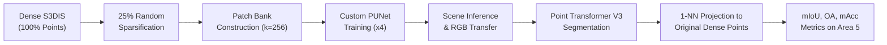

# Learning-Based Point-Cloud Upsampling for Improved Semantic Segmentation of Sparse 3D Point Clouds

[](https://www.python.org/downloads/release/python-3100/)
[](https://pytorch.org/)
[](https://github.com/Pointcept/Pointcept)
[](https://opensource.org/licenses/MIT)

---

## 1. Project Motivation and Research Question

Acquiring dense 3D point clouds via LiDAR or structured-light scanners is often constrained by capture time, sensor resolution, range limitations, and transmission bandwidth. Consequently, deployed 3D perception models frequently operate on sparse point clouds, which suffer from reduced structural context and missing geometric boundaries.

This project investigates the central research question:
> **Does learning-based 3D point-cloud upsampling upstream of a state-of-the-art segmentation network (Point Transformer V3) meaningfully improve semantic segmentation accuracy on sparse indoor point clouds compared with direct sparse training and naive interpolation?**

Rather than evaluating geometric upsampling in isolation (e.g. Chamfer Distance on synthetic CAD models), this repository establishes an end-to-end evaluation pipeline on real-world indoor scenes from the Stanford Large-Scale 3D Indoor Spaces (S3DIS) benchmark.

---

## 2. Proposed Method

We design and evaluate a two-stage perception pipeline:
1. **Geometric Super-Resolution:** A deep point-cloud upsampler network (`PUNet`) based on dense EdgeConv feature extractors, global feature aggregation, NodeShuffle channel-to-point expansion, and coordinate offset regression with residual connections. The network is trained with a composite loss combining:
   - **Chamfer Distance (CD):** Minimizes geometric surface reconstruction error.
   - **Repulsion Loss:** Penalizes point clustering to prevent localized bunching.
   - **Uniformity Loss:** Enforces uniform spatial distribution across local neighborhoods.
2. **Feature Transfer & Upsampled Inference:** Sparse scenes are upsampled by extracting overlapping spherical patches via Farthest Point Sampling (FPS) and random centers, inferring dense coordinates, filtering spatial outliers, and assigning RGB colors from sparse neighbors via nearest-neighbor or inverse-distance weighting.
3. **Semantic Segmentation:** Point Transformer V3 (PTv3) segments the upsampled point cloud.
4. **Fair Dense Projection:** Predictions from the upsampled or sparse models are mapped back to the **original dense points** via 1-nearest-neighbor indexing. All experimental rows are evaluated on the exact same ground-truth point cloud, ensuring direct and fair metric comparisons.

---

## 3. Pipeline Overview



---

## 4. Dataset and Train/Test Split

We use the Stanford Large-Scale 3D Indoor Spaces (S3DIS) dataset comprising 272 rooms across 6 large-scale indoor areas:
- **Standard 6-Fold Split:**
  - **Training / Development:** `Area_1`, `Area_2`, `Area_3`, `Area_4`, `Area_6` (204 rooms).
  - **Test Set:** `Area_5` (68 rooms).
- **Strict Data Isolation:** `Area_5` is strictly excluded from all training stages, patch-bank creation, and checkpoint selection (`evaluate=False`). When upsampling training rooms for cross-fit experiments (Row H), label transfer is masked so `Area_5` receives dummy labels (`-1`).
- **Feature Representation:** RGB colors only (coordinates normalized; no surface normals, ensuring parity between raw scans and upsampled points).

---

## 5. Repository Structure

```text
point-cloud-upsampling/
├── pcseg/                      # Core Python implementation package
│   ├── common.py               # Shared constants, class mappings, I/O
│   ├── compat.py               # Shims, stubs, and Pointcept runtime patches
│   ├── data_check.py           # S3DIS data integrity verification
│   ├── env_setup.py            # CUDA, PyTorch, SpConv, and Pointcept setup
│   ├── eval_dense.py           # 1-NN projection and dense metric evaluation
│   ├── experiments.py          # Unified experiment configuration factory
│   ├── make_configs.py         # Config generation & hook/crop patching
│   ├── pu_core.py              # PUNet architecture, losses, patch metrics
│   ├── pu_data.py              # Patch extraction, scene inference, interpolation
│   ├── pu_infer.py             # CLI for full-scene upsampling inference
│   ├── pu_train.py             # CLI for upsampler training loop
│   ├── results.py              # Result JSON collation and Markdown tables
│   ├── run.py                  # Subprocess execution and Pointcept runners
│   ├── settings.py             # Central path management and budget knobs
│   ├── up_metrics.py           # Scene-level Chamfer, Hausdorff, Uniformity
│   └── viz.py                  # 3D qualitative panel visualizations
├── notebooks/                  # Reproducible Jupyter workflows
│   ├── pcseg_part2_pointcept_baselines.ipynb  # Environment, benchmark, Rows A-D
│   ├── pcseg_part3_upsampler.ipynb            # Patch banks, upsampler, ablations
│   └── pcseg_part4_pipeline_results.ipynb     # Inference, Rows E-H, evaluation
├── scripts/                    # Headless runners
│   └── run_ptv3.py             # Batch runner for long PTv3 training jobs
├── tests/                      # Verification and regression test suite
│   ├── synth.py                # Synthetic S3DIS generator
│   ├── test_make_configs.py    # Config generation & hook filtering test
│   ├── test_numpy_parts.py     # Patch banks, confusion matrix CPU tests
│   ├── test_pred_shape.py      # Prediction/label broadcasting regression test
│   ├── test_sphere_crop.py     # Evaluation fragmentation regression test
│   └── test_torch_cpu.py       # Upsampler forward/backward CPU test
├── docs/                       # Project documentation and audit reports
│   ├── EXPERIMENT_STATUS.md    # Experiment execution tracking and provenance
│   ├── GITHUB_RELEASE_CHECKLIST.md # Release verification checklist
│   ├── LOCAL_RUN_GUIDE.md      # Detailed local setup and execution guide
│   ├── PRESENTATION_AND_VIVA.md# Presentation scripts and viva preparation
│   └── PROJECT_FILE_INVENTORY.md # Detailed file and module inventory
├── requirements.txt            # Python dependencies
└── README.md                   # This document
```

---

## 6. Software and Hardware Requirements

### Hardware Requirements
- **Target GPU:** NVIDIA GPU with $\ge 16\text{ GB}$ VRAM (tested on NVIDIA RTX 2000 Ada 16 GB and Tesla T4 16 GB).
- **RAM:** $\ge 16\text{ GB}$ system RAM.
- **Disk Storage:** $\ge 40\text{ GB}$ free SSD storage (processed data ~7.6 GB, upsampled data ~7 GB, checkpoints and predictions ~10 GB).

### Software Requirements
- **OS:** Linux (Ubuntu 22.04+ or Fedora 40+) or Windows 11 with WSL2.
- **Python:** Python 3.10.
- **PyTorch Stack:** PyTorch 2.5.0 with CUDA 12.4 (`cu124`), `torchvision` 0.20.0, `spconv-cu124` 2.3.6.

---

## 7. Environment Setup

```bash
# 1. Clone the repository
git clone https://github.com/duckydodo/point-cloud-upsampling.git
cd point-cloud-upsampling

# 2. Create conda environment
conda create -n pcseg python=3.10 -y
conda activate pcseg

# 3. Install PyTorch with CUDA 12.4
pip install torch==2.5.0 torchvision==0.20.0 --index-url https://download.pytorch.org/whl/cu124

# 4. Install project requirements
pip install -r requirements.txt

# 5. Optional: install torch-scatter (pure-PyTorch fallback shim included if omitted)
pip install torch-scatter -f https://data.pyg.org/whl/torch-2.5.0+cu124.html
```

---

## 8. Data Preparation Instructions

1. Download the processed S3DIS dataset backups into `workspace/data/`:
   - `workspace/data/s3dis/` (Dense rooms: `Area_1` to `Area_6`)
   - `workspace/data/s3dis_sparse25/` (25% uniform subsampled rooms)
2. Verify dataset integrity:
   ```bash
   python -m pcseg.data_check
   ```
   *Expected output:* Confirms 272 rooms across 6 areas, valid feature dimensions, and ~0.25 subsampling ratio.

---

## 9. Notebook Execution Order

The research workflow is partitioned into three sequential notebooks:
1. `notebooks/pcseg_part2_pointcept_baselines.ipynb`:
   - Checks environment and CUDA availability.
   - Clones Pointcept (commit `1342eda`) and applies compatibility shims.
   - Runs speed benchmark (102 iterations) to select schedule budget.
   - **Phase 0 Gate:** Trains short 20-epoch models (`P0_dense`, `P0_sparse25`) to quantify baseline mIoU degradation under 25% sparsity.
   - Trains and evaluates full baselines: Row A (dense), Row B (sparse25), Row C (dense-on-sparse), Row D (density augmented).
2. `notebooks/pcseg_part3_upsampler.ipynb`:
   - Builds training and validation patch banks (`train_dev_x4.npz`, `val_x4.npz`).
   - Trains development upsampler `dev_x4` and loss ablation variants.
   - Trains production upsampler `full_x4` and cross-fit models (`foldA_x4`, `foldB_x4`).
   - Evaluates geometric reconstruction metrics (Chamfer distance, Hausdorff distance, uniformity) on Area 5 rooms.
3. `notebooks/pcseg_part4_pipeline_results.ipynb`:
   - Upsamples Area 5 using naive interpolation (Row E) and learned upsampler (Row G).
   - Generates cross-fit training scenes and trains Row H (`H_up_trained`).
   - Collates final results table, ablation studies, and generates qualitative visualization figures.

---

## 10. Training and Evaluation Commands

### Running Headless Baselines
```bash
# Run baseline models A, B, and D in sequence
python scripts/run_ptv3.py A B D

# Run cross-fit trained model H
python scripts/run_ptv3.py H
```

### Running the Upsampler CLI
```bash
# Train learned upsampler
python -m pcseg.pu_train \
  --train-bank workspace/banks/train_dev_x4.npz \
  --val-bank workspace/banks/val_x4.npz \
  --out workspace/upsampler/dev_x4 \
  --epochs 30 --batch 32 --lr 1e-3

# Full scene upsampling inference
python -m pcseg.pu_infer \
  --method model \
  --ckpt workspace/upsampler/full_x4/best.pt \
  --sparse-root workspace/data/s3dis_sparse25 \
  --dense-root workspace/data/s3dis \
  --dst workspace/data/s3dis_up25x4 \
  --areas Area_5
```

---

## 11. Metrics and Evaluation Methodology

- **Semantic Segmentation Metrics:**
  - **Mean Intersection-over-Union (mIoU):** Primary evaluation metric averaged across 13 S3DIS semantic classes.
  - **Overall Accuracy (OA):** Total correctly classified points divided by total points.
  - **Mean Class Accuracy (mAcc):** Average classification accuracy across classes.
- **Fair Dense Projection:**
  $$\hat{y}_{\text{dense}} = \hat{y}_{\text{pred}}[\text{1-NN}(x_{\text{dense}}, x_{\text{input}})]$$
  All metrics are computed on the identical set of original dense ground-truth points using `pcseg/eval_dense.py`.
- **Geometric Super-Resolution Metrics:**
  - **Chamfer Distance (CD):** Symmetric mean nearest-neighbor distance (cm).
  - **Robust Hausdorff Distance (HD99):** 99th-percentile nearest-neighbor distance (cm).
  - **F-score ($F@1\text{cm}, F@2\text{cm}$):** Harmonic mean of precision and recall within distance thresholds.
  - **Uniformity ($CV$):** Coefficient of variation of local 8-NN point distances.

---

## 12. Results and Evidence Status

The repository contains experiment code and cleared notebooks, but no saved checkpoints, prediction files, evaluation summaries, or notebook execution outputs. The quantitative experiment matrix has therefore **not been verified from artifacts in this repository**. Do not interpret the architecture, schedules, hardware targets, or example commands above as evidence that the corresponding experiments completed.

The downloaded training logs inspected for this repository end while resuming the `P0_dense` and `P0_sparse25` jobs at epoch 5. They do not establish completion of the proposed 20-epoch runs or provide an Area 5 evaluation. The previously reported throughput estimate and completed-checkpoint claims are not reproduced here as verified results.

The codebase includes fixes for evaluator-hook handling, fragmented test-time crops, and prediction-shape broadcasting. These are implementation claims supported by source and focused regression tests; they do not establish that the full PTv3 experiment matrix or learned upsampling pipeline has completed.

---

## 13. Limitations and Current Status

- **Point Transformer V3 Configuration:** PTv3 is configured for RGB-only inputs (`in_channels=3`, no surface normals) because upsampled points do not possess original scanner normals. Consequently, absolute mIoU values are lower than published benchmarks that rely on true surface normals.
- **Experiment status:** PTv3 baselines, learned upsampler training, full-scene inference, and Area 5 quantitative evaluation remain unverified. See [`docs/EXPERIMENT_STATUS.md`](docs/EXPERIMENT_STATUS.md) for provenance and the current evidence boundary.
- **Projected versus measured:** Values, runtime estimates, hardware assumptions, and expected outputs in plans or commands are targets or examples unless accompanied by saved logs/checkpoints and reproducible evaluation artifacts. No mIoU, OA, mAcc, or geometric metric result is claimed here.

---

## 14. Reproduction and Testing

Run the local regression and unit test suite:
```bash
python tests/test_make_configs.py
python tests/test_pred_shape.py
python tests/test_sphere_crop.py
```

---

## 15. Citations

```bibtex
@inproceedings{armeni20163d,
  title={3D semantic parsing of large-scale indoor spaces},
  author={Armeni, Iro and Sener, Ozan and Zamir, Amir R and Jiang, Hao and Brilakis, Ioannis and Fischer, Martin and Savarese, Silvio},
  booktitle={CVPR},
  pages={1534--1543},
  year={2016}
}

@inproceedings{wu2024pointcept,
  title={Point Transformer V3: Simpler, Faster, Stronger},
  author={Wu, Xiaoyang and Jiang, Li and Wang, Peng-Shuai and Liu, Zhijian and Liu, Xihui and Yan, Rui and Dong, Yue and Chen, Qifeng and Zhao, Hengshuang},
  booktitle={CVPR},
  pages={20261--20271},
  year={2024}
}

@inproceedings{yu2018pu,
  title={PU-Net: Point Cloud Upsampling Network},
  author={Yu, Lequan and Li, Xianzhi and Fu, Chi-Wing and Cohen-Or, Daniel and Heng, Pheng-Ann},
  booktitle={CVPR},
  pages={2790--2799},
  year={2018}
}
```
