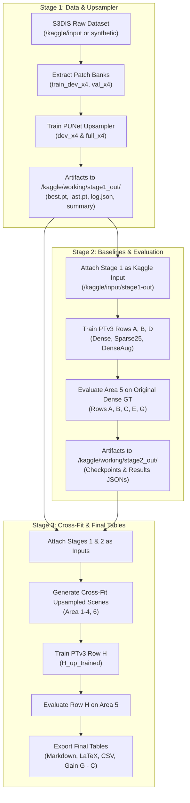

# Modular Kaggle Headless Batch Execution Guide

This directory contains standalone Python runners and matching cleared Jupyter notebooks designed specifically for Kaggle's **"Save & Run All"** batch environment (NVIDIA T4 or T4 ×2, 12-hour session limit, ~19.5 GB `/kaggle/working` persistence cap, ephemeral `/tmp` scratch space).

---

## 1. Pipeline Overview & Execution Stages

Execution is partitioned into 3 sequential stages to fit safely within Kaggle's per-session time and disk quotas:



---

## 2. Directory Structure

```text
kaggle/
├── README.md                          # This runbook
├── kaggle_utils.py                    # Shared Kaggle utilities (environment, GPU pinning, TimeGuard)
├── stage1_data_and_upsampler.py       # Stage 1 executable Python runner
├── stage1_data_and_upsampler.ipynb    # Stage 1 cleared Jupyter notebook
├── stage2_baselines_and_eval.py       # Stage 2 executable Python runner
├── stage2_baselines_and_eval.ipynb    # Stage 2 cleared Jupyter notebook
├── stage3_crossfit_and_tables.py      # Stage 3 executable Python runner
└── stage3_crossfit_and_tables.ipynb   # Stage 3 cleared Jupyter notebook
```

---

## 3. How to Run on Kaggle

### Stage 1: Data Preparation & Upsampler Training
1. In Kaggle, create a new Notebook with **GPU T4** or **GPU T4 x2** accelerator.
2. Upload `kaggle/stage1_data_and_upsampler.ipynb` or run:
   ```bash
   python kaggle/stage1_data_and_upsampler.py
   ```
   *(For a fast 5-minute sanity test, append `--smoke-test`)*.
3. Click **"Save Version" -> "Save & Run All (Commit)"**.
4. Once completed, create a new Kaggle Dataset from the notebook's output (`stage1_out`).

### Stage 2: PTv3 Baselines & Area 5 Evaluation
1. Create a second Kaggle Notebook.
2. Under **"Add Input"**, attach:
   - Your S3DIS dataset (or synthetic).
   - The Stage 1 output dataset (`stage1_out`).
3. Upload `kaggle/stage2_baselines_and_eval.ipynb` or run:
   ```bash
   python kaggle/stage2_baselines_and_eval.py --stage1-input /kaggle/input/stage1-out
   ```
4. Click **"Save & Run All (Commit)"**.
5. Save the notebook's output (`stage2_out`) as a Kaggle Dataset.

### Stage 3: Cross-Fit Row H & Final Tables
1. Create a third Kaggle Notebook.
2. Under **"Add Input"**, attach:
   - Stage 1 output dataset (`stage1_out`).
   - Stage 2 output dataset (`stage2_out`).
3. Upload `kaggle/stage3_crossfit_and_tables.ipynb` or run:
   ```bash
   python kaggle/stage3_crossfit_and_tables.py \
       --stage1-input /kaggle/input/stage1-out \
       --stage2-input /kaggle/input/stage2-out
   ```
4. Click **"Save & Run All (Commit)"**.
5. Download final tables and metrics from `/kaggle/working/final_results/`:
   - `summary_table.md` (Markdown summary with mIoU, OA, mAcc, and class-wise IoU)
   - `results_matrix.csv` (CSV matrix for plotting or spreadsheet analysis)
   - `summary_table.tex` (LaTeX table for academic paper inclusion)

---

## 4. Key Engineering Features

- **Fast `--smoke-test` Mode:** Every stage supports `--smoke-test`, creating synthetic scenes (1,000 points, 1 room per area) and running 1–2 epochs. This verifies the complete data flow, training step, model inference, and artifact export in under 5 minutes.
- **Graceful TimeGuard (`11.5` hours):** Kaggle notebooks kill jobs at 12.0 hours without saving outputs. The built-in `TimeGuard` monitors elapsed wall-clock time and cleanly terminates long loops before 11.5 hours, flushing checkpoints and results safely to disk.
- **Disk Cap Preservation:** Heavy operations, raw Pointcept build repositories, and temporary tensors remain inside `/tmp/workspace` (high-capacity scratch space). Only compact checkpoints and evaluation JSONs are copied to `/kaggle/working/` (staying well below the 19.5 GB limit).
- **Multi-GPU / Single-T4 Compatibility:** Automatically detects available GPUs and sets `CUDA_VISIBLE_DEVICES=0` when running Pointcept to avoid single-node distributed deadlocks.
